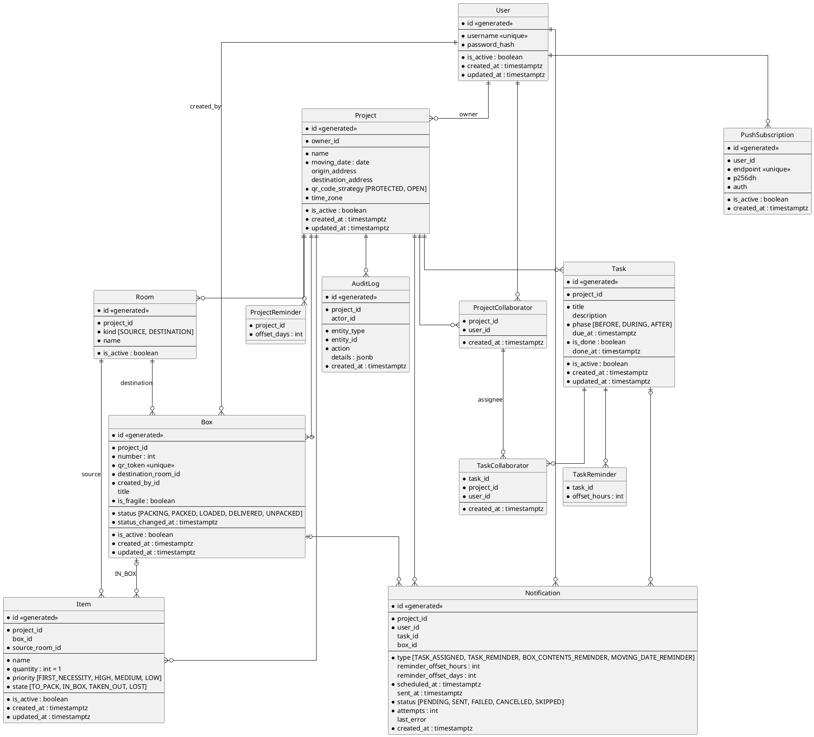

# MoverMate — структура БД

Документ описывает итоговую модель данных, принятые решения и нюансы, выведенные в ходе обсуждения.
Стек: Python, FastAPI, PostgreSQL 18, SQLAlchemy 2.1 (async), asyncpg, Alembic, taskiq с брокером Redis (фоновые задачи; очередь уведомлений — таблица `notifications`, раздел 10.3, [ADR 0011](adr/0011-notification-worker.md)).

Все первичные ключи `id` имеют тип `uuid` и генерируются как UUIDv7 в домене (`new_id()` в `domain/common/ids.py`, `uuid.uuid7` из стандартной библиотеки): сущность получает идентификатор в момент создания, до записи в БД. `DEFAULT` на стороне БД не задаётся. UUIDv7 упорядочен по времени создания, поэтому вставки в индексы идут почти последовательно. Идентификатор содержит время создания и не является секретом, поэтому доступ защищается проверкой участия в проекте, а публичным идентификатором коробки в QR остаётся отдельный случайный `qr_token`. Все внешние ключи на `id` и колонки `*_id` (включая `entity_id` в журнале) тоже имеют тип `uuid`.

---

## 1. Сводка принятых решений

| # | Решение |
|---|---------|
| 1 | Мягкое удаление через `is_active` везде, где есть сущность с жизненным циклом (`User`, `Project`, `Room`, `Task`, `Box`, `Item`, `PushSubscription`). Связующие таблицы (`ProjectCollaborator`, `TaskCollaborator`, `TaskReminder`) удаляются физически. |
| 2 | Статусы коробки: `PACKING → PACKED → LOADED → DELIVERED → UNPACKED`. Пропуск этапов запрещён, откат — на один шаг назад с записью в журнал. `UNPACKED` ставится вручную. |
| 3 | Комнаты «откуда» и «куда» — разные сущности (`Room.kind`). У коробки только `destination_room_id`. `source_room_id` есть только у вещи. |
| 4 | Состояния вещи: `TO_PACK`, `IN_BOX`, `TAKEN_OUT`, `LOST`. `box_id` заполнен только у `IN_BOX`. |
| 5 | Номер коробки уникален в проекте среди активных коробок. Выдаётся минимальный свободный. Номер не освобождается при переходе в `UNPACKED`, только при удалении коробки. |
| 6 | Удаление коробки с вещами допустимо (подтверждение на фронтенде), каскадное и мягкое. |
| 7 | Поиск вещей — полнотекстовый (FTS, конфиг `russian`), без отдельной колонки нормализации. |
| 8 | Ответственные назначаются на задачу и должны быть участниками проекта (`TaskCollaborator`). Их может быть несколько. |
| 9 | У задачи есть этап `phase`: `BEFORE`, `DURING` (день переезда) или `AFTER`, по умолчанию `BEFORE`. На нём построен экран плана (три колонки). Срок — `due_at` с временем, необязательный. |
| 10 | Шаблоны задач лежат в файле, у каждого стабильный `id` и `phase`. Пользователь сам выбирает шаблоны, и они копируются в задачи; автоматического копирования при создании проекта нет. Связь задачи с шаблоном не хранится, дубли допустимы. Срок и ответственные у шаблона не задаются. |
| 11 | Чек-лист первого дня — не отдельная сущность, а предметы с приоритетом `FIRST_NECESSITY`. Приоритет пользователь выставляет сам, файла-шаблона предметов нет. Пункт выполнен, когда вещь в состоянии `TAKEN_OUT`. |
| 12 | Уведомления — только Web Push (VAPID). Очередь отправки лежит в БД, доставку выполняет воркер taskiq (брокер Redis), которого планировщик будит каждые 15 секунд ([ADR 0011](adr/0011-notification-worker.md)). |
| 13 | ML-часть (раздел 6 ТЗ) не реализуется. |
| 14 | Список для упаковки сортируется по `priority`, затем по названию в алфавитном порядке (по возрастанию), затем по `id`. |
| 15 | Чек-лист погрузки строится по комнатам «откуда» (`Item.source_room_id`). |
| 16 | Все `id` — `uuid` (UUIDv7), генерируются в домене. |
| 17 | Удалённый пользователь освобождает `username`. Удалить пользователя, который владеет активными проектами, нельзя. |
| 18 | Переходы вещи между состояниями заданы явной матрицей (раздел 5.2). |
| 19 | `created_at` и `updated_at` ставит БД (`server_default now()`, `onupdate`), домен их не хранит. Времена с бизнес-смыслом (`status_changed_at`, `done_at`, `scheduled_at`, время записи журнала) задаёт домен. |
| 20 | У коробки есть краткое описание `title` и флаг `is_fragile` (печатается на этикетке). В ТЗ их нет, но без описания коробку не найти взглядом в длинном списке. |
| 21 | Участникам напоминают о дате переезда: смещения в днях (0..365) хранятся у проекта (`ProjectReminder`), тип уведомления `MOVING_DATE_REMINDER`, время отправки — 09:00 по часовому поясу проекта (`time_zone`). |
| 22 | Удалить проект может только владелец (403 `not_project_owner`). |

---

## 2. Осознанные отличия от ТЗ

| Пункт ТЗ | Решение | Комментарий |
|----------|---------|-------------|
| 8: «без внешних сервисов», «нет скрытых передач данных третьим лицам» | Web Push | Push идёт через сервис производителя браузера или ОС (Google, Mozilla, Apple). Содержимое шифруется, но сам факт отправки виден этим сервисам. Подписка добровольная, приложение работает и без неё. Исключение нужно явно записать в README. |
| 8: «запуск без сложных внешних настроек» | taskiq требует брокер, используется Redis; ключи VAPID создаются сами | Требование понято как «не нужно выпускать токены и вводить ключи вручную». Redis, воркер и планировщик поднимаются вместе с остальными сервисами в `docker-compose` без настройки, пара ключей VAPID создаётся при первом использовании в томе `vapid`. См. разделы 10.4 и 10.5. |
| 5.4: чек-лист первого дня | Приоритет предмета | Отдельной таблицы нет. |
| 6: ML | Не реализуется | |
| (нет в ТЗ) | Аккаунты и участники проекта | Минимум персональных данных: `username` и хэш пароля, без e-mail. |

---

## 3. ER-диаграмма



---

## 4. Сущности

### 4.1. User

| Поле | Тип | Обяз. | Описание |
|------|-----|-------|----------|
| id | | да | |
| username | varchar(32) | да | Хранится в нижнем регистре (`CHECK (username = lower(username))`), поэтому уникален без учёта регистра. Уникален среди активных: `UNIQUE (username) WHERE is_active`. Удалённый пользователь освобождает имя; восстановить его можно, только если имя никто не занял (иначе 409). |
| password_hash | text | да | Хэш (argon2 или bcrypt), открытый пароль не хранится. |
| is_active | bool | да | Мягкое удаление. |
| created_at, updated_at | timestamptz | да | |

### 4.2. Project

| Поле | Тип | Обяз. | Описание |
|------|-----|-------|----------|
| owner_id | FK User | да | Владелец. |
| name | varchar(200) | да | |
| moving_date | date | да | |
| origin_address, destination_address | text | нет | Используются только внутри проекта. |
| qr_code_strategy | varchar + CHECK | да | `PROTECTED` (по умолчанию) или `OPEN`. Проверяется в момент запроса, поэтому переключение действует и на уже напечатанные этикетки. |
| time_zone | varchar(64) | да | IANA-имя (`Europe/Moscow`), где проходит переезд. Проверяет домен (`TimeZone` сверяет с базой tz). Нужен только напоминаниям о переезде. Добавлен миграцией `0006`. |
| is_active, created_at, updated_at | | да | |

Удаляет проект только владелец (иначе 403), остальные участники могут лишь выйти из него.

**ProjectReminder** (часть агрегата `Project`): PK `(project_id, offset_days)`, `CHECK (offset_days BETWEEN 0 AND 365)`. За сколько дней до `moving_date` напомнить всем участникам; 0 — утром в день переезда. Момент отправки — 09:00 по `time_zone` проекта в день `moving_date − offset_days` (`Project.moving_reminder_at`), в `scheduled_at` он хранится в UTC. Фиксированное время в UTC отклонено: 09:00 UTC — это 12:00 в Москве и 18:00 во Владивостоке ([ADR 0010](adr/0010-projects-api.md)).

### 4.3. ProjectCollaborator

PK `(project_id, user_id)`.

- Запись владельца создаётся автоматически в той же транзакции, что и проект. Владельца из проекта убрать нельзя.
- Все участники равноправны, ролей нет. Участников добавляют по `username`.
- При удалении участника каскадно удаляются его назначения (`TaskCollaborator`), а его ожидающие уведомления в этом проекте отменяются (см. 10.2).

### 4.4. Room

| Поле | Описание |
|------|----------|
| project_id | |
| kind | `SOURCE` (откуда) или `DESTINATION` (куда). |
| name | `UNIQUE (project_id, kind, name) WHERE is_active`. |
| is_active | Мягкое удаление. |

Порядок отображения не хранится: комнаты сортируются по имени. Поле `sort_order` убрано сознательно, его можно добавить позже.

`UNIQUE (project_id, id)` нужен как цель составных внешних ключей. То, что `Item.source_room_id` указывает на комнату с `kind = SOURCE`, а `Box.destination_room_id` на комнату с `kind = DESTINATION`, внешний ключ не выражает, поэтому проверка выполняется в домене: `Box.create`, `Item.create` и методы смены комнаты принимают сущность `Room` и проверяют её `kind` (при желании дублируется триггером).

### 4.5. Task

| Поле | Тип | Обяз. | Описание |
|------|-----|-------|----------|
| project_id | FK | да | |
| title | varchar(200) | да | |
| description | varchar(5000) | нет | |
| phase | varchar + CHECK | да | `BEFORE` (по умолчанию), `DURING` (день переезда), `AFTER`. Колонка на экране плана. |
| due_at | timestamptz | нет | Срок с временем. Напоминания возможны только при заданном сроке. |
| is_done | bool | да | `CHECK (is_done = (done_at IS NOT NULL))`. |
| done_at | timestamptz | нет | |
| is_active, created_at, updated_at | | да | |

`UNIQUE (id, project_id)` — цель составного внешнего ключа из `TaskCollaborator`.

Сортировка задач внутри этапа: `due_at NULLS LAST, id`; индекс `(project_id, phase, due_at) WHERE is_active`.

### 4.6. TaskCollaborator (ответственные за задачу)

- PK `(task_id, user_id)`, колонка `project_id` дублируется для проверки согласованности.
- `FOREIGN KEY (task_id, project_id) REFERENCES tasks (id, project_id) ON DELETE CASCADE`.
- `FOREIGN KEY (project_id, user_id) REFERENCES project_collaborators (project_id, user_id) ON DELETE CASCADE`. Ответственным может быть только участник проекта, а при его удалении из проекта назначение исчезает.

### 4.7. TaskReminder

PK `(task_id, offset_hours)`. `offset_hours` — за сколько часов до `due_at` напомнить, целое число: `CHECK (offset_hours BETWEEN 1 AND 8760)` (от часа до года). Фиксированного списка вариантов нет: пресеты («за 2 часа», «за день», «за неделю») предлагает фронтенд. У задачи может быть несколько напоминаний сразу. Если `due_at` очищается, напоминания удаляются (правило агрегата `Task`).

Допустимая альтернатива без отдельной таблицы: массив `Task.reminder_offsets_hours`.

### 4.8. Box

| Поле | Тип | Обяз. | Описание |
|------|-----|-------|----------|
| project_id | FK | да | |
| number | int | да | `CHECK (number > 0)`. См. раздел 6. |
| qr_token | varchar(32) | да | Случайный токен (`secrets.token_urlsafe(16)`, 128 бит), `UNIQUE`. В QR кодируется ссылка с токеном, а не номером. |
| destination_room_id | FK Room | да | Комната назначения. |
| created_by_id | FK User | да | Адресат напоминания об отложенном содержимом. |
| title | varchar(200) | нет | Краткое описание («Посуда на первое время»). |
| is_fragile | bool | да | «Хрупкое», печатается на этикетке. |
| status | varchar + CHECK | да | См. 5.1. |
| status_changed_at | timestamptz | да | |
| is_active, created_at, updated_at | | да | |

Ограничения:
- `UNIQUE (project_id, number) WHERE is_active`.
- `UNIQUE (qr_token)`.
- `UNIQUE (project_id, id)` для составных внешних ключей.
- `FOREIGN KEY (project_id, destination_room_id) REFERENCES rooms (project_id, id)`.

Поля `contents_remind_at` у коробки нет: время напоминания хранится только в `Notification`, чтобы не дублировать данные.

### 4.9. Item

| Поле | Тип | Обяз. | Описание |
|------|-----|-------|----------|
| project_id | FK | да | Нужен, потому что `box_id` часто пуст. |
| box_id | FK Box | нет | Заполнен только при `state = IN_BOX`. |
| source_room_id | FK Room | да | Комната, из которой вещь. Основа подсказок для потерянных вещей. |
| name | varchar(200) | да | |
| quantity | int | да | По умолчанию 1, `CHECK (quantity BETWEEN 1 AND 10000)`. |
| priority | smallint | да | `0` FIRST_NECESSITY, `1` HIGH, `2` MEDIUM (по умолчанию), `3` LOW. `CHECK (priority BETWEEN 0 AND 3)`. Число, а не строка, чтобы сортировка работала без `CASE`. |
| state | varchar + CHECK | да | См. 5.2. |
| is_active, created_at, updated_at | | да | |

Главный инвариант:

```sql
CHECK ((state = 'IN_BOX') = (box_id IS NOT NULL))
```

Составные внешние ключи `(project_id, box_id) → boxes (project_id, id)` и `(project_id, source_room_id) → rooms (project_id, id)` не дают сослаться на коробку или комнату другого проекта. Для строк с `box_id IS NULL` проверка не выполняется (MATCH SIMPLE).

Сортировка при упаковке: сначала по `priority` (`FIRST_NECESSITY` первым), затем по названию в алфавитном порядке по возрастанию, затем по `id`: `ORDER BY priority, lower(name), id`. Для корректного алфавитного порядка кириллицы нужна UTF-8-локаль БД или ICU-коллация.

### 4.10. Notification

Очередь отправки push-уведомлений (transactional outbox). Одна строка — одно уведомление одному пользователю.

| Поле | Описание |
|------|----------|
| project_id, user_id | Адресат и проект. `project_id` нужен для массовой отмены при удалении участника. |
| type | `TASK_ASSIGNED`, `TASK_REMINDER`, `BOX_CONTENTS_REMINDER`, `MOVING_DATE_REMINDER`. |
| task_id / box_id | Ровно одно из двух, в зависимости от типа; у `MOVING_DATE_REMINDER` оба пусты (уведомление о самом проекте). |
| reminder_offset_hours | Только для `TASK_REMINDER`: смещение напоминания задачи в часах. |
| reminder_offset_days | Только для `MOVING_DATE_REMINDER`: за сколько дней до переезда. |
| scheduled_at | Когда отправлять. |
| status | `PENDING`, `SENT`, `FAILED`, `CANCELLED`, `SKIPPED` (у пользователя нет активных подписок). |
| attempts, last_error, sent_at, created_at | Служебные поля. |

Ограничения:
- `CHECK` на соответствие типа и заполненных полей: `BOX_CONTENTS_REMINDER` требует `box_id` и пустой `task_id`; `TASK_ASSIGNED` и `TASK_REMINDER` требуют `task_id` и пустой `box_id`; `MOVING_DATE_REMINDER` — оба пустых. `reminder_offset_hours` заполнен тогда и только тогда, когда тип `TASK_REMINDER`, `reminder_offset_days` — когда `MOVING_DATE_REMINDER`.
- Частичные `UNIQUE`, защищающие от дублей ожидающих уведомлений: `(task_id, user_id, reminder_offset_hours) WHERE type = 'TASK_REMINDER' AND status = 'PENDING'`, `(box_id, user_id) WHERE type = 'BOX_CONTENTS_REMINDER' AND status = 'PENDING'` и `(project_id, user_id, reminder_offset_days) WHERE type = 'MOVING_DATE_REMINDER' AND status = 'PENDING'`.
- Индекс для выборки: `(scheduled_at) WHERE status = 'PENDING'`.
- Текст уведомления в таблице не хранится: он собирается в момент отправки из актуальных данных.

### 4.11. PushSubscription

| Поле | Описание |
|------|----------|
| user_id | |
| endpoint | `UNIQUE`. Если тот же браузер подписывается под другим пользователем, запись переназначается (upsert по `endpoint`). |
| p256dh, auth | Ключи подписки Web Push. |
| is_active | Сбрасывается, когда push-сервис отвечает 404 или 410, ключи непригодны для шифрования или пользователь отписал браузер (`DELETE /push/subscriptions`). Повторная подписка того же `endpoint` возвращает `true`. |

### 4.12. AuditLog

Журнал важных событий. Внешних ключей на `entity_id` нет, чтобы журнал переживал удаление объектов.

| Поле | Описание |
|------|----------|
| project_id | Индекс `(project_id, created_at DESC)`. |
| actor_id | Кто выполнил действие (`NULL` для системных). |
| entity_type, entity_id | Тип объекта и его `uuid`. |
| action | См. список ниже. |
| details | `jsonb`, например `{"from": "PACKED", "to": "LOADED"}`. |
| created_at | |

События (минимум по ТЗ плюс полезные дополнения): `PROJECT_CREATED`, `BOX_CREATED`, `BOX_STATUS_CHANGED`, `BOX_STATUS_ROLLED_BACK`, `BOX_DELETED`, `TASK_CREATED`, `TASK_COMPLETED`, `TASK_REOPENED`, `ITEM_MARKED_LOST`, `ITEM_RETURNED`.

---

## 5. Жизненные циклы

### 5.1. Статусы коробки

```
PACKING → PACKED → LOADED → DELIVERED → UNPACKED
```

- Вперёд только на один шаг. `LOADED` достижим только из `PACKED`.
- Назад — тоже на один шаг, с записью `BOX_STATUS_ROLLED_BACK` в журнал.
- Запрос текущего статуса ничего не меняет и не считается ошибкой (повтор запроса безопасен). Остальные переходы — 409.
- `UNPACKED` пользователь ставит вручную, когда открыл коробку. Выкладывание вещей — отдельное ручное действие, они между собой не связаны.
- Вещи можно добавлять в коробку с любым статусом, статус при этом не меняется.
- Пустую коробку собрать (`PACKING → PACKED`) можно. Ожидающее напоминание о содержимом при этом отменяется.
- Смена статуса защищена от гонок условным обновлением:

```sql
UPDATE boxes
SET status = :new, status_changed_at = now()
WHERE id = :id AND status = :expected AND is_active;
-- rowcount = 0 → 409 Conflict
```

### 5.2. Состояния вещи

| state | box_id | Смысл |
|-------|--------|-------|
| `TO_PACK` | NULL | Записана, лежит в комнате `source_room_id`, ещё не упакована. |
| `IN_BOX` | NOT NULL | Лежит в коробке. |
| `TAKEN_OUT` | NULL | Пользователь выложил вещь из коробки. В какую комнату, не важно. |
| `LOST` | NULL | Потеряна. `source_room_id` остаётся основой подсказок. |

Переходы (матрица `ITEM_TRANSITIONS` в домене):

| Из \ В | `TO_PACK` | `IN_BOX` | `TAKEN_OUT` | `LOST` |
|--------|-----------|----------|-------------|--------|
| `TO_PACK` | — | упаковали | нет | потеряли |
| `IN_BOX` | вынули обратно | переложили в другую коробку | выложили | потеряли |
| `TAKEN_OUT` | нет | положили снова | — | потеряли |
| `LOST` | нашли в исходной комнате | нашли в коробке | нашли на месте | — |

- Повтор текущего состояния (та же коробка, повторная потеря) ничего не меняет и не считается ошибкой: так безопасны повторы запросов. Переход вне матрицы — 409.
- Положить вещь можно в коробку с любым статусом, в том числе в ту, где она лежала до потери.
- При потере `box_id` обнуляется. Подсказки от него не зависят.

### 5.3. Подсказка для потерянной вещи

Показываем активные коробки проекта не в статусе `UNPACKED`, в которых лежат вещи из той же комнаты (`source_room_id`), ранжируя по числу таких вещей:

```sql
SELECT b.id, b.number, b.status, count(*) AS matches
FROM items i
JOIN boxes b ON b.id = i.box_id
WHERE i.project_id = :p
  AND i.is_active
  AND i.state = 'IN_BOX'
  AND i.source_room_id = :lost_item_source_room_id
  AND b.is_active
  AND b.status <> 'UNPACKED'
GROUP BY b.id, b.number, b.status
ORDER BY matches DESC, b.number;
```

Исключать коробку самой вещи не нужно: у потерянной вещи `box_id` пуст.

### 5.4. Чек-листы и прогресс

- **Чек-лист погрузки** строится по комнатам «откуда»: для каждой комнаты `SOURCE` показываются коробки, в которых лежат её вещи (`IN_BOX`, по `Item.source_room_id`), и статус каждой. Комната считается погруженной, если у неё нет активных вещей `TO_PACK` и все такие коробки в статусе `LOADED` или дальше.
- **Прогресс распаковки** считается по комнатам назначения: число коробок `UNPACKED` из всех активных коробок с этим `destination_room_id`.
- **Чек-лист первого дня** — активные вещи проекта с `priority = FIRST_NECESSITY`. Пункт выполнен, когда вещь в состоянии `TAKEN_OUT`. Приоритет пользователь выставляет сам.
- Количество коробок в каждом статусе — агрегат по `Box.status` среди активных коробок.

---

## 6. Нумерация коробок

Правило: минимальный свободный положительный номер среди активных коробок проекта. Номер освобождается только при удалении коробки, `UNPACKED` его не освобождает.

Две параллельные транзакции не видят незакоммиченных вставок друг друга и выберут один номер. Поэтому создание коробки сериализуется блокировкой строки проекта. `SELECT` здесь нужен только ради блокировки, его результат не используется:

```python
async with session.begin():
    await session.execute(
        select(Project.id)
        .where(Project.id == project_id)
        .with_for_update(key_share=True)   # FOR NO KEY UPDATE
    )
    number = await next_free_number(session, project_id)
    session.add(Box(project_id=project_id, number=number, ...))
```

`FOR NO KEY UPDATE` не конфликтует с проверками внешних ключей других вставок (они берут `FOR KEY SHARE`), но конфликтует с такой же блокировкой, поэтому создание коробок в одном проекте выстраивается в очередь. Уровень изоляции должен оставаться `READ COMMITTED`.

```sql
SELECT s.n
FROM generate_series(
       1,
       (SELECT COALESCE(MAX(number), 0) + 1 FROM boxes WHERE project_id = :p AND is_active)
     ) AS s(n)
WHERE NOT EXISTS (
  SELECT 1 FROM boxes WHERE project_id = :p AND is_active AND number = s.n
)
ORDER BY s.n
LIMIT 1;
```

`UNIQUE (project_id, number) WHERE is_active` остаётся страховкой при любых ошибках в коде.

---

## 7. Поиск вещей

Полнотекстовый поиск с конфигом `russian`:

```sql
CREATE INDEX ix_items_name_fts ON items
  USING gin (to_tsvector('russian'::regconfig, name))
  WHERE is_active;
```

```sql
SELECT i.id, i.name, i.state, b.number, b.status, r.name AS destination_room
FROM items i
LEFT JOIN boxes b ON b.id = i.box_id AND b.is_active
LEFT JOIN rooms r ON r.id = b.destination_room_id
WHERE i.project_id = :p
  AND i.is_active
  AND to_tsvector('russian'::regconfig, i.name) @@ to_tsquery('russian'::regconfig, :q)
ORDER BY ts_rank_cd(to_tsvector('russian'::regconfig, i.name),
                    to_tsquery('russian'::regconfig, :q)) DESC,
         b.number NULLS LAST,
         i.id;
```

Нюансы:
- Запрос пользователя разбивается в Python по `\w+`, каждое слово превращается в `слово:*`, слова соединяются через `&`. Операторы tsquery в запрос попасть не могут. Пустой запрос возвращает пустой результат.
- В запросе и в индексе нужно использовать то же выражение, а конфиг передавать литералом `'russian'::regconfig`, а не bind-параметром, иначе планировщик может не использовать индекс. Эти выражения стоит вынести в одну функцию. Альтернатива: колонка `name_tsv tsvector GENERATED ALWAYS AS (to_tsvector('russian', name)) STORED` с GIN-индексом.
- Alembic autogenerate не отслеживает выражения в индексах, создавайте индекс вручную через `op.execute` или `op.create_index` с `postgresql_where`.
- Стеммер даёт одинаковую основу для «зарядки» и «зарядка», но формы с беглой гласной («носок», «носки») могут не склеиться. Проверяйте через `SELECT to_tsvector('russian', 'носок носки')`.
- Поиска по середине слова и устойчивости к опечаткам нет. При необходимости позже добавляется `pg_trgm` без изменения таблиц.
- Результаты детерминированы: сортировка заканчивается уникальным `i.id`.
- Ищутся все активные вещи проекта, включая находящиеся в коробках `UNPACKED`. Для вещей вне коробок (`TO_PACK`, `TAKEN_OUT`, `LOST`) в результате указывается состояние и `source_room_id`.
- Кодировка БД — UTF-8, проверить `SHOW lc_ctype` (локаль `C` плохо работает с кириллицей при сортировке).

Поиск коробки по номеру: `WHERE project_id = :p AND number = :n AND is_active`, в том числе среди `UNPACKED`.

---

## 8. QR-коды и доступ

В QR кодируется ссылка вида `/b/{qr_token}`. Номер и комната назначения печатаются на этикетке отдельным текстом. Токен привязан к коробке, а не к номеру: если номер удалённой коробки выдан новой, старая этикетка не откроет новую коробку (по токену удалённой коробки возвращается 404).

| Режим | Без входа | Участник проекта | Вошедший, не участник |
|-------|-----------|------------------|-----------------------|
| `PROTECTED` (по умолчанию) | нет ни чтения, ни записи: 401, клиент сам отправляет на вход и возвращает на ту же ссылку | чтение и запись | 404 |
| `OPEN` | только чтение карточки | чтение и запись | только чтение |

Изменять статусы и содержимое могут только участники проекта.

---

## 9. Удаление

| Объект | Что происходит |
|--------|----------------|
| Project | Только владелец (иначе 403). `is_active = false`, дочерние данные не трогаются, все запросы проверяют активность проекта. Ожидающие уведомления проекта отменяются. |
| Box | `is_active = false` и в той же транзакции `is_active = false` у вещей `IN_BOX` этой коробки (каскад). Вещи с пустым `box_id` не затрагиваются. Ожидающие уведомления по коробке отменяются. Номер освобождается. Подтверждение запрашивает фронтенд. |
| Item | `is_active = false`. |
| Room | Допущение: запрещено, пока на комнату ссылаются активные коробки или вещи (см. раздел 12). |
| Task | `is_active = false`, ожидающие уведомления по задаче отменяются. |
| ProjectCollaborator | Физическое удаление. Каскадом удаляются `TaskCollaborator`. Ожидающие уведомления пользователя в проекте отменяются. Владельца удалить нельзя. |
| User | `is_active = false`, имя освобождается, все сессии отзываются. Запрещено (409), пока пользователь владеет активными проектами: сначала проект нужно удалить. Участником чужих проектов удалённый пользователь остаётся (скрыт из списка участников, после восстановления виден снова), но войти не может. |

Физического удаления (purge) в приложении нет. Внешние ключи без каскада защищают от случайного `DELETE`.

---

## 10. Уведомления

### 10.1. События

| Тип | Кому | Когда | Условие отправки |
|-----|------|-------|------------------|
| `BOX_CONTENTS_REMINDER` | только создателю коробки (`created_by_id`) | через заданное им время | в момент отправки коробка активна и в статусе `PACKING` |
| `TASK_ASSIGNED` | каждому добавленному ответственному, кроме того, кто назначил себя сам | сразу после назначения | — |
| `TASK_REMINDER` | всем ответственным за задачу | `due_at − offset_hours` для каждого смещения задачи | задача активна и не выполнена |
| `MOVING_DATE_REMINDER` | всем участникам проекта | в 09:00 по `time_zone` проекта за `offset_days` дней до `moving_date` (0 — в день переезда, см. 4.2) | проект активен |

### 10.2. Правила ведения очереди

Уведомления создаются в той же транзакции, что и вызвавшее их изменение, поэтому ни одно не теряется.

- Напоминание о содержимом отменяется (`CANCELLED`), когда коробка переходит в `PACKED`, удаляется или пользователь покидает проект.
- При добавлении ответственного создаются его `TASK_REMINDER` по всем выбранным смещениям.
- При добавлении смещения создаются уведомления для всех текущих ответственных.
- Если `scheduled_at` уже в прошлом, уведомление не создаётся.
- При изменении `due_at` ожидающие уведомления пересчитываются, а те, что оказались в прошлом, отменяются.
- Отмена происходит при: выполнении задачи, удалении задачи, удалении ответственного, удалении смещения, очистке `due_at`.
- Напоминания о дате переезда создаются при добавлении смещения или участника, пересчитываются при изменении `moving_date` или `time_zone` (ожидающие отменяются и создаются заново), отменяются при удалении смещения или проекта и при выходе участника.
- Если у пользователя нет активных подписок, уведомление получает статус `SKIPPED`.

### 10.3. Отправка

Источник истины — таблица `Notification`. Периодическая задача taskiq `deliver_due_notifications` запускается каждые 15 секунд (`WORKER__INTERVAL_SECONDS`) и обрабатывает до 100 созревших уведомлений (`WORKER__BATCH_SIZE`), по одному на транзакцию:

```sql
SELECT ...
FROM notifications
WHERE status = 'PENDING' AND scheduled_at <= now()
ORDER BY scheduled_at, id
LIMIT 1
FOR UPDATE SKIP LOCKED;
```

Каждое уведомление обрабатывается в своей транзакции (`DeliverNextNotification`):
1. Повторно проверяется условие отправки (10.1), а также что проект активен, получатель не удалён и остаётся участником. Условие не выполнено — `CANCELLED`.
2. Текст собирается из текущих данных (`application/notifications/services.py`) и отправляется на все активные подписки пользователя (pywebpush, асинхронный `send_async`).
3. Доставлено хотя бы на одну подписку — `SENT`. Подписок нет или все отпали — `SKIPPED`. Только ошибки — `attempts` растёт, `scheduled_at` сдвигается на 1, 2, 4, 8 минут, после пятой попытки статус `FAILED` (`Notification.record_failure`).
4. Ответ 404 или 410 от push-сервиса или непригодные ключи означают `PushSubscription.is_active = false`.

Задержка доставки — до 15 секунд. Благодаря опросу БД потеря сообщения брокера или перезапуск воркера не теряют уведомлений. Доставка «хотя бы один раз»: строка заблокирована, пока идёт отправка, поэтому падение воркера до коммита не теряет уведомление, но может отправить его повторно. `SKIP LOCKED` позволяет запустить несколько воркеров.

Payload — JSON `{title, body, url, type, project_id, notification_id}` плюс `task_id` или `box_id`. `url` — путь фронтенда: `/plan` для задач, `/b/{qr_token}` для коробки, `/dashboard` для напоминания о переезде. Срок задачи в тексте показывается в часовом поясе проекта.

### 10.4. Брокер taskiq: Redis

Выбран брокер Redis (`taskiq-redis`: `TimeoutListQueueBroker`, наследник `ListQueueBroker` с таймаутом BRPOP, список `taskiq:notifications`). Требование ТЗ о запуске без сложных внешних настроек понято как отсутствие ручного выпуска токенов и ввода ключей: Redis поднимается в `docker-compose` без настройки.

- Состав сервисов: API, воркер taskiq (`worker`), планировщик taskiq (`scheduler`), Redis, PostgreSQL.
- Планировщику достаточно одной статической задачи через `LabelScheduleSource` (метки задач): `interval` 15 секунд с постоянным `schedule_id`. Планировщик запускается в одном экземпляре. Динамическое расписание на каждое уведомление не нужно, потому что источником истины остаётся таблица `Notification`.
- `RedisScheduleSource` из `taskiq-redis` позволил бы планировать отправку точно ко времени, но тогда расписание живёт в двух местах, и потерю данных в Redis придётся компенсировать пересчётом из `Notification`. Для минутной точности это избыточно.
- Сообщение в Redis — только сигнал «пора». Потерянное, вытесненное или повторное сообщение стоит задержки или пустого запуска. Пока Redis недоступен, уведомления задерживаются, но не теряются: ожидающие записи остаются в PostgreSQL и уйдут после его возвращения.
- Задержку видно по `/health/ready` (проверка `notifications` становится `degraded`, когда самое старое ожидающее уведомление просрочено больше чем на 5 минут) и по healthcheck контейнера `worker`.

### 10.5. VAPID и подписки

- Пара ключей VAPID создаётся автоматически при первом использовании и хранится в томе `vapid` (`PUSH__VAPID_KEY_FILE`), общем для API и воркера; вместо файла можно задать `PUSH__VAPID_PRIVATE_KEY` (PEM). Контакт для claim `sub` — `PUSH__VAPID_SUBJECT` (`mailto:` или `https://`, в проде по умолчанию `https://$DOMAIN`). Потеря ключа ломает все подписки: том хранится так же бережно, как данные БД.
- Подписка добровольная: пользователь сам включает уведомления в браузере. Клиент отправляет подписку (`PUT /api/v1/push/subscriptions`) после подписки и при каждом запуске, а при выходе из аккаунта отписывает браузер (`DELETE`).
- Нужны HTTPS (кроме `localhost`) и service worker. На iOS приложение должно быть добавлено на домашний экран как PWA.
- В тексте push не показывается содержимое коробок.

---

## 11. Индексы и ограничения

Имена таблиц — во множественном числе, как у таблиц шаблона (`users`, `refresh_tokens`). В тексте выше сущности названы в единственном числе. Схему создаёт миграция `0004`, дополняют `0005` и `0006`, модели лежат в `src/app/infrastructure/db/models/`.

| Таблица | Ограничение или индекс | Зачем |
|---------|------------------------|-------|
| users | `UNIQUE (username) WHERE is_active`; `CHECK (username = lower(username))` | Уникальность имён без учёта регистра среди активных. |
| projects | `INDEX (owner_id)`; `CHECK` значений `qr_code_strategy` | Список проектов. |
| project_collaborators | PK `(project_id, user_id)`; `INDEX (user_id)` | Участники, проекты пользователя. |
| project_reminders | PK `(project_id, offset_days)`; `CHECK (offset_days BETWEEN 0 AND 365)` (с миграции `0006`); FK `ON DELETE CASCADE` | Нет дублей напоминаний о дате переезда. |
| rooms | `UNIQUE (project_id, id)`; `UNIQUE (project_id, kind, name) WHERE is_active`; `CHECK` значений `kind` | Цель составных FK, нет дублей имён. |
| tasks | `UNIQUE (id, project_id)`; `INDEX (project_id, due_at) WHERE is_active`; `INDEX (project_id, phase, due_at) WHERE is_active`; `CHECK (is_done = (done_at IS NOT NULL))`; `CHECK` значений `phase` | Цель FK, план по этапам, ближайшая задача. |
| task_reminders | PK `(task_id, offset_hours)`; `CHECK (offset_hours BETWEEN 1 AND 8760)`; FK `ON DELETE CASCADE` | Нет дублей напоминаний, разумный диапазон. |
| task_collaborators | PK `(task_id, user_id)`; два составных FK `ON DELETE CASCADE` (4.6) | Ответственные только из участников проекта. |
| boxes | `UNIQUE (project_id, number) WHERE is_active`; `UNIQUE (qr_token)`; `UNIQUE (project_id, id)`; составной FK на `rooms`; `CHECK (number > 0)`; `CHECK (length(qr_token) = 22)`; `CHECK` значений `status`; триггер переходов `status` (5.1); `INDEX (project_id, status) WHERE is_active`; `INDEX (project_id, destination_room_id) WHERE is_active` | Номера, QR, переходы, счётчики по статусам и комнатам. |
| items | `CHECK ((state = 'IN_BOX') = (box_id IS NOT NULL))`; `CHECK (quantity BETWEEN 1 AND 10000)`; `CHECK (priority BETWEEN 0 AND 3)`; `CHECK` значений `state`; триггер переходов `state` (5.2); составные FK на `boxes` и `rooms`; GIN FTS (раздел 7); `INDEX (box_id) WHERE box_id IS NOT NULL`; `INDEX (project_id, state, priority) WHERE is_active`; `INDEX (project_id, source_room_id) WHERE is_active AND state = 'IN_BOX'` | Инварианты, поиск, содержимое коробки, список упаковки, подсказки. |
| notifications | `CHECK` по типам и значениям; `CHECK (attempts >= 0)`; триггер «статус меняется только из `PENDING`»; три частичных `UNIQUE` (4.10); `INDEX (scheduled_at) WHERE status = 'PENDING'`; `INDEX (project_id, user_id) WHERE status = 'PENDING'` | Нет дублей, быстрый выбор, массовая отмена при выходе из проекта. |
| push_subscriptions | `UNIQUE (endpoint)`; `INDEX (user_id) WHERE is_active` | Upsert подписки, отправка. |
| audit_logs | `INDEX (project_id, created_at)`; `CHECK` значений `action` и `entity_type`; `CHECK (entity_type = split_part(action, '_', 1))` | Просмотр журнала (B-tree читается в обратном порядке так же быстро, `DESC` не нужен). |

Общие правила:
- Перечисления хранятся как `VARCHAR + CHECK`: колонка `String`, а `CHECK (... IN (...))` строится из доменного перечисления (`infrastructure/db/constraints.py`). Приоритет вещи — `SMALLINT`. Нативные enum плохо переживают миграции.
- Матрицы переходов (`BOX_TRANSITIONS`, `ITEM_TRANSITIONS`, `NOTIFICATION_TRANSITIONS`) продублированы триггерами. Нарушение приходит как `check_violation` с именем ограничения (`ck_boxes_status_transition`, `ck_items_state_transition`, `ck_notifications_status_transition`), поэтому репозиторий распознаёт его как обычный CHECK. Тест перебирает все пары переходов и сверяет домен с БД.
- Все времена — `timestamptz` в UTC. Сроки задач абсолютные, пользователь видит их в своём часовом поясе. Часовой пояс проекта (`projects.time_zone`) нужен только напоминаниям о переезде: у `moving_date` нет времени, и момент 09:00 по местному времени вычисляется из него.
- Длинные списки (коробки, вещи, журнал) отдаются постранично, предпочтительно keyset-пагинацией по `(number)`, `(priority, name, id)`, `(created_at, id)`.
- Частичные и выражения-индексы описаны в моделях, их предикаты сверяет тест миграций. Триггеры есть только в миграциях.

---

## 12. Допущения и открытые вопросы

Ниже то, что я выбрал по умолчанию, не получив прямого подтверждения. Ни один пункт не меняет набор таблиц.

1. **Удаление комнаты.** Предлагается запретить, пока на неё ссылаются активные коробки или вещи.
2. **Приоритет по умолчанию** — `MEDIUM`.

Решённые вопросы: переходы вещи заданы явной матрицей (раздел 5.2); удалённый пользователь освобождает имя, а владельца активных проектов удалить нельзя (раздел 9).

---

## 13. Покрытие требований ТЗ

| Требование | Реализация |
|------------|------------|
| 5.1 Проект, шаблоны, свои задачи, этапы, сроки, ответственные, отметка выполнения | `Project`, `Task` (`phase`), `TaskCollaborator`, файл шаблонов с ручным выбором |
| 5.2 Коробки, номера, комната, вещи, статусы, отложенное содержимое, удаление | `Box`, `Item`, `Notification`, раздел 6, раздел 9 |
| 5.3 Поиск по названию и номеру, этикетка с номером, комнатой и QR, открытие по QR | Раздел 7, раздел 8 |
| 5.4 Погрузка по комнатам, доставка, счётчики по статусам, прогресс распаковки по комнатам, чек-лист первого дня, потерянные вещи, подсказки | Агрегаты по `Box.status` и `destination_room_id`; приоритет `FIRST_NECESSITY`; `state = LOST`; разделы 5.3 и 5.4 |
| 5.5 Памятки | Хранятся файлами, в БД не нужны |
| 8 Уникальные номера | `UNIQUE (project_id, number) WHERE is_active` |
| 8 Повторное сканирование не создаёт дубликатов | Токен открывает существующую коробку |
| 8 Допустимые переходы статусов | Раздел 5.1 |
| 8 Детерминированный поиск | Сортировка с уникальным tie-breaker |
| 8 Сотни коробок и тысячи вещей, пагинация | Раздел 11 |
| 8 Журнал событий | `AuditLog` |
| 8 Проверка работоспособности | `/health` с запросом `SELECT 1` (вне схемы БД) |

---

## 14. Агрегаты домена

Таблицы отображаются на агрегаты слоя `domain`. Модули не импортируют друг друга, ссылки между ними — только идентификаторы из `domain/common/ids.py`.

| Модуль | Агрегат | Таблицы | Инварианты в домене |
|--------|---------|---------|---------------------|
| `users` | `User` | `users` | формат `username`, мягкое удаление |
| `projects` | `Project` (участники и напоминания о дате внутри) | `projects`, `project_collaborators`, `project_reminders` | владелец всегда участник и не удаляется; удаляет проект только владелец; доступ по QR (раздел 8) |
| `inventory` | `Room`, `Box`, `Item` (три агрегата) | `rooms`, `boxes`, `items` | вид комнаты у коробки и вещи; один проект; переходы статусов (5.1) и состояний (5.2); `box_id` только у `IN_BOX` |
| `tasks` | `Task` (ответственные и напоминания внутри) | `tasks`, `task_collaborators`, `task_reminders` | `done_at` ⇔ выполнена; напоминания только при сроке |
| `notifications` | `Notification`, `PushSubscription` | `notifications`, `push_subscriptions` | тип ⇔ заполненные поля; переходы только из `PENDING`; повторы с задержкой |
| `audit` | `AuditEntry` (неизменяемая запись) | `audit_logs` | тип объекта выводится из действия |

Правила, которые требуют данных нескольких агрегатов (номер коробки, участие ответственного в проекте, запрет удаления комнаты и владельца проектов, каскад удаления коробки, ведение очереди уведомлений), выполняют use cases в одной транзакции.

---

Источники: [RFC 8030 (Web Push)](https://www.rfc-editor.org/rfc/rfc8030), [RFC 8291 (шифрование сообщений)](https://www.rfc-editor.org/rfc/rfc8291), [RFC 8292 (VAPID)](https://www.rfc-editor.org/rfc/rfc8292), [pywebpush на PyPI](https://pypi.org/project/pywebpush/2.5.0/), [Schedule sources в документации taskiq](https://taskiq-python.github.io/available-components/schedule-sources.html), [taskiq-redis на PyPI](https://pypi.org/project/taskiq-redis/1.2.4/).
